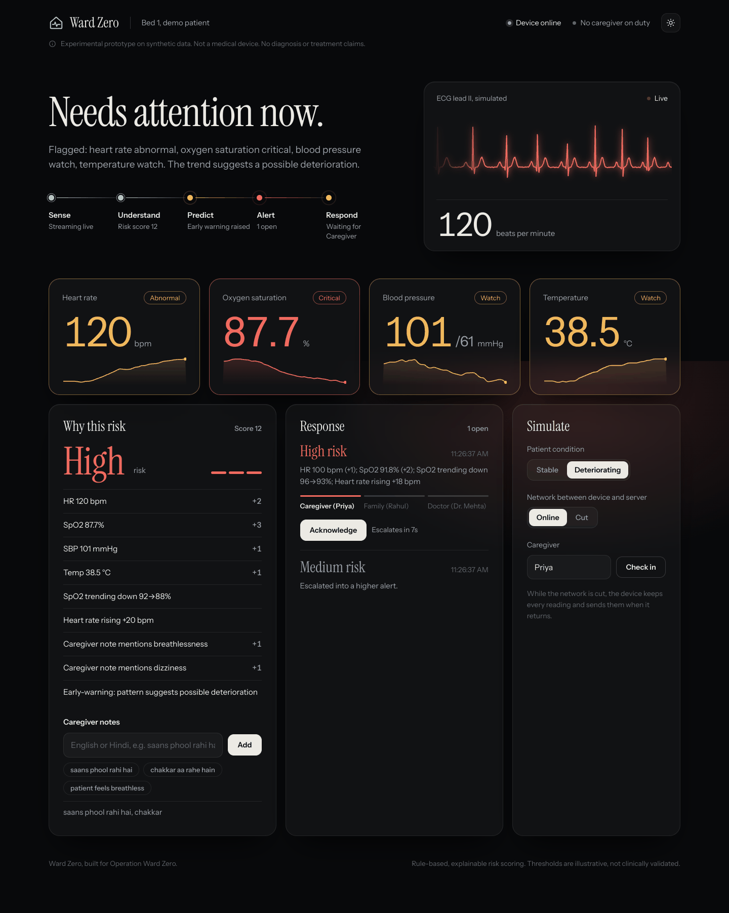
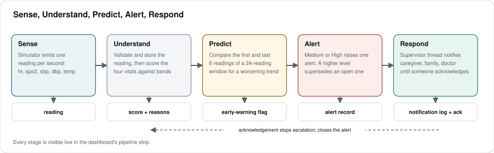
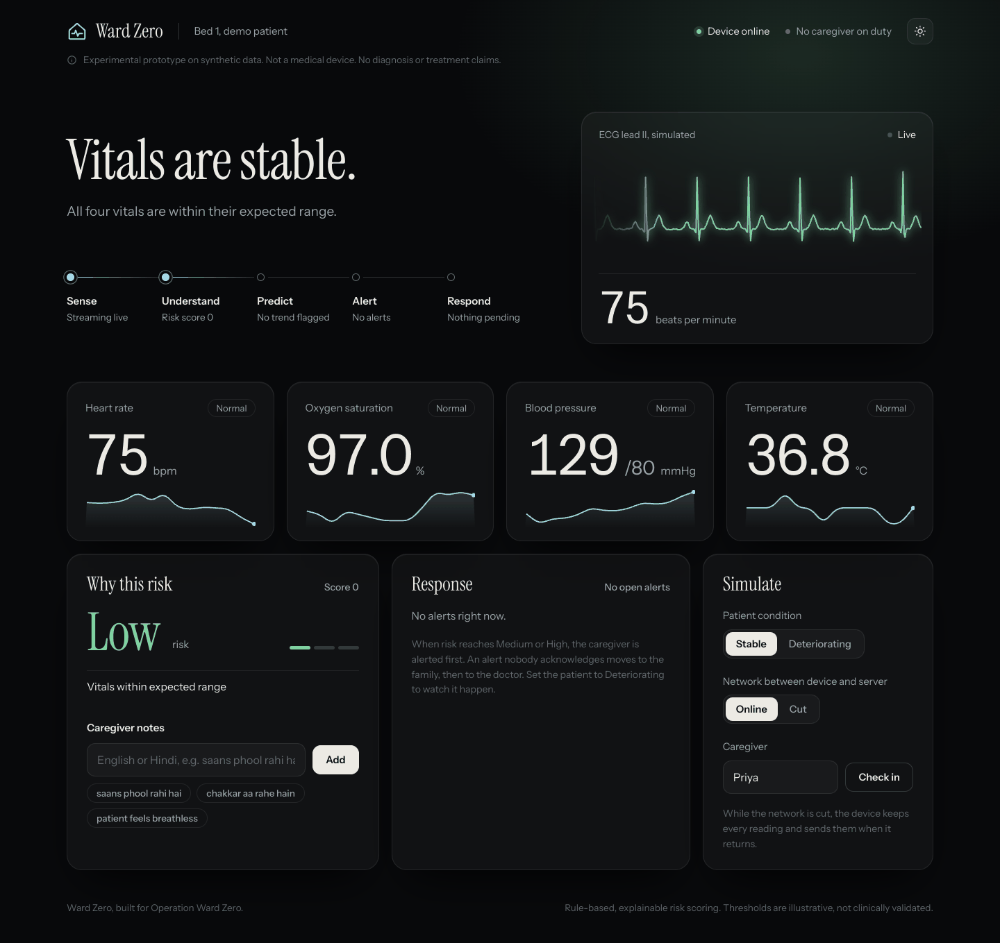
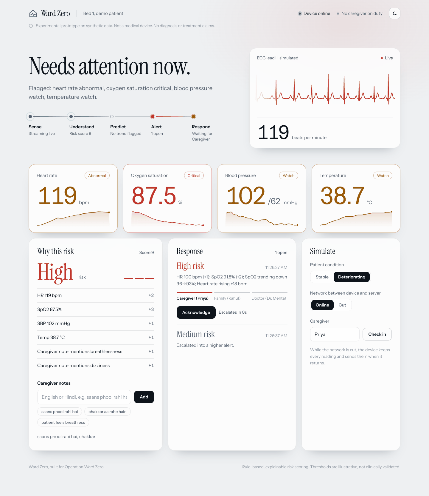
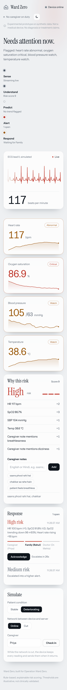
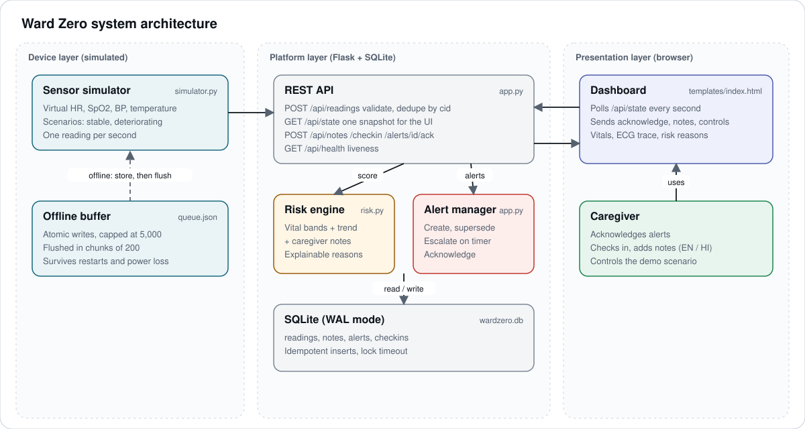
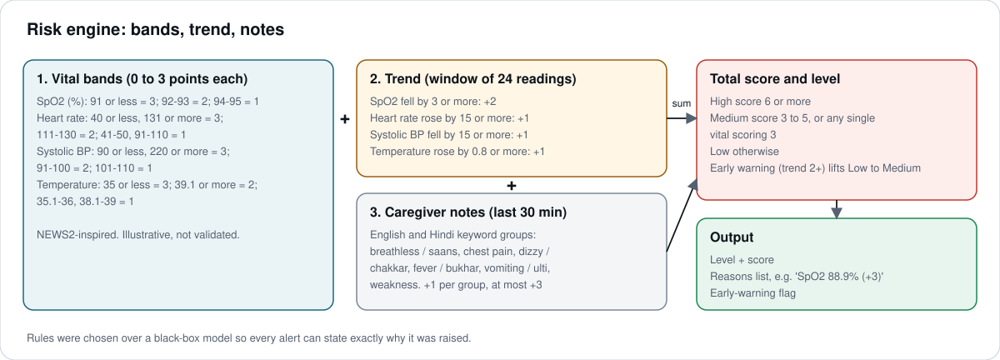
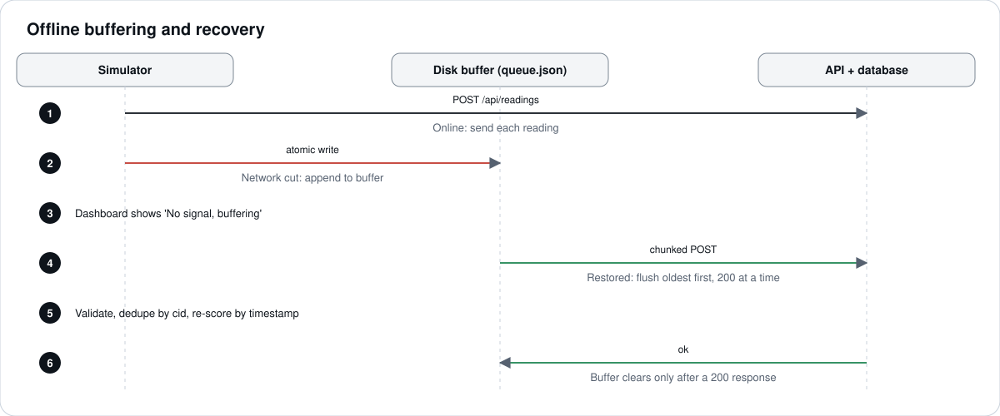
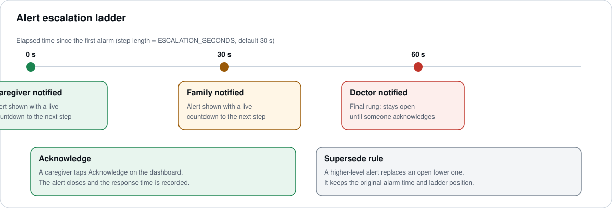

<p align="center"></p>
<h1 align="center">Ward Zero</h1>
<p align="center"><b>A hospital ward inside a bedroom.</b><br>Simulated vitals, explainable risk scoring, alert escalation and caregiver response, in one working prototype.</p>

<p align="center">
  <a href="https://github.com/satyam-64136/Ward-Zero/actions/workflows/ci.yml"></a>
  
  
  
</p>



> **Experimental prototype.** Synthetic data only. Not a medical device. It makes no diagnosis or treatment claims, and its thresholds are illustrative, not clinically validated.

Built for **Operation Ward Zero** (Nursio Innovation, hosted on Wooble and Unstop).

## What it does

At home, a patient usually has a family member and a thermometer. Ward Zero shows what continuous, ward-level awareness could look like, without any hardware.

```
Sense  ->  Understand  ->  Predict  ->  Alert  ->  Respond
```

1. **Sense**: a simulated device streams heart rate, SpO2, blood pressure and temperature every second.
2. **Understand**: each reading is validated, stored and scored against NEWS2-inspired bands.
3. **Predict**: a trend check over a 24-reading window raises an early warning before values become critical.
4. **Alert**: Medium and High risk raise one alert that states exactly why.
5. **Respond**: a supervisor thread escalates the alert caregiver, then family, then doctor, logging a (simulated) push, SMS and voice call at each step, until someone acknowledges it. It runs with no browser open.

If the device goes silent, that is an alert too: no readings for 45 seconds raises a **signal lost** alert, and it closes itself when data returns.



## Highlights

| Evaluation criterion | How it is addressed | Where to look |
|---|---|---|
| End-to-end integration (25%) | One live flow from simulator to acknowledgement, visible stage by stage on the dashboard | [Architecture](docs/ARCHITECTURE.md) |
| Technical skills (20%) | Small validated REST API, pure risk engine, 33 tests plus a 15-check end-to-end script against the real server, CI with lint and security scan, two decision records | [Assessment](docs/ASSESSMENT.md), [ADRs](docs/adr), [Code tour](docs/CODE_TOUR.md) |
| Reliability and resilience (20%) | Disk-backed offline buffer, chunked flush, idempotent writes, input validation, WAL database, signal-loss alert, unattended escalation | [Resilience](#reliability) |
| Practical implementation (20%) | Caregiver check-in, escalation ladder with a notification log, English and Hindi notes, one-command demo, Docker files | [Quick start](#quick-start) |
| Explainability and clinical safety (15%) | Every score lists its reasons, early warnings say "possible", disclaimers on every screen | [Risk model](docs/RISK_MODEL.md) |

## Quick start

Requires Python 3.11 or newer.

**Windows (PowerShell)**
```powershell
git clone https://github.com/satyam-64136/Ward-Zero.git
cd Ward-Zero
py -m venv .venv
.\.venv\Scripts\Activate.ps1
pip install -r requirements.txt
python demo.py
```

**macOS / Linux**
```bash
git clone https://github.com/satyam-64136/Ward-Zero.git
cd Ward-Zero
python3 -m venv .venv && source .venv/bin/activate
pip install -r requirements.txt
python demo.py
```

`demo.py` starts the API and the sensor simulator together and opens <http://127.0.0.1:5000>. Prefer separate terminals? Run `python app.py` and `python simulator.py`.

**Docker**
```bash
docker compose up --build
```

## Demo walkthrough

| Step | Action | What you see |
|---|---|---|
| 1 | Open the dashboard, enter a name, press **Check in** | Caregiver shown as on duty |
| 2 | Under Simulate, choose **Deteriorating** | SpO2 falls, heart rate rises, an early warning appears, risk climbs to High |
| 3 | Add the note `saans phool rahi hai, chakkar` | Hindi symptom keywords add to the score |
| 4 | Wait, do not acknowledge | The alert escalates to family, then the doctor; each step appears in the notification log under the alert |
| 5 | Press **Acknowledge** | The alert closes and the response time is recorded |
| 6 | Choose **Cut** under Network, wait, then **Online** | Device buffers readings, then syncs them with no loss and no duplicates |
| 7 | Keep the network cut for longer than `SIGNAL_LOSS_SECONDS` (default 45; start with `SIGNAL_LOSS_SECONDS=10` to see it quickly) | Headline becomes "No signal from the device" and a **Signal lost** alert escalates; restoring the network closes it automatically |

A timed script for the 3-minute video is in [docs/DEMO_SCRIPT.md](docs/DEMO_SCRIPT.md).

| Stable | Light theme | Mobile |
|---|---|---|
|  |  |  |

## Architecture



Components, data model and design decisions: [docs/ARCHITECTURE.md](docs/ARCHITECTURE.md). Endpoints: [docs/API.md](docs/API.md).

## Risk model



A transparent rules model was chosen over a black box so that every alert can say why it was raised. Full tables and a worked example: [docs/RISK_MODEL.md](docs/RISK_MODEL.md).

## Reliability



- The device writes every reading to an atomic on-disk buffer and clears it only after the server confirms receipt.
- The API validates each reading, rejects bad ones without failing the batch, and ignores duplicates by client id.
- The dashboard shows device state honestly: online, no recent data, or network cut.
- Escalation is driven by the server clock in a supervisor thread, so it continues without anyone watching the screen.
- A device that goes silent raises its own alert instead of leaving the last risk on screen as if it were current.



## Safety and privacy

- Synthetic data only. Do not connect real patient data to this prototype.
- Wording is deliberately hedged: "possible deterioration", never a diagnosis.
- The server listens on localhost by default and sends `Cache-Control: no-store` on every API response.
- There is no authentication yet. See [SECURITY.md](SECURITY.md) before exposing it to a network.

## Configuration

| Variable | Default | Purpose |
|---|---|---|
| `PORT` | `5000` | API port |
| `HOST` | `127.0.0.1` | Bind address (localhost only by default) |
| `WARDZERO_DB` | `wardzero.db` | SQLite file |
| `ESCALATION_SECONDS` | `30` | Seconds per escalation step |
| `NOTE_WINDOW_SECONDS` | `1800` | How long a caregiver note influences risk |
| `SIGNAL_LOSS_SECONDS` | `45` | Silence longer than this raises a signal-lost alert |
| `WARDZERO_WORKER` | `1` | Set to `0` to disable the supervisor thread (tests do this) |
| `API` | `http://127.0.0.1:5000` | Simulator target |

## Project structure

```
app.py                 Flask API, storage, alerts, escalation
risk.py                Explainable risk engine
simulator.py           Virtual sensors with offline buffering
demo.py                One-command launcher
templates/index.html   Dashboard (served as-is)
static/fonts/          Self-hosted Instrument Sans and Serif (OFL)
test_ward.py           API, alert, escalation and signal-loss tests
test_risk.py           Risk engine unit tests
scripts/               Diagram generator, end-to-end check against the real server
docs/                  Architecture, API, risk model, assessment, roadmap, code tour, ADRs
assets/                Logo and its design brief
.github/               CI workflow, issue and pull request templates
Dockerfile, docker-compose.yml
```

## Development

```bash
pip install -r requirements-dev.txt
ruff check .
python -m unittest -v
python scripts/e2e_check.py         # boots the real server, 15 checks, about 25 s
bandit -q -r app.py risk.py simulator.py demo.py scripts/e2e_check.py
python scripts/make_diagrams.py     # regenerate docs/images/*.svg
```

See [CONTRIBUTING.md](CONTRIBUTING.md) and the [CHANGELOG](CHANGELOG.md).

## Documentation

| Document | Contents |
|---|---|
| [Technical documentation](docs/TECHNICAL_DOCUMENTATION.md) | Problem, solution, stack, features, assumptions, limitations |
| [Architecture](docs/ARCHITECTURE.md) | Components, data model, sequence, design decisions |
| [API reference](docs/API.md) | Every endpoint with examples |
| [Risk model](docs/RISK_MODEL.md) | Scoring tables, worked example, safety notes |
| [Engineering assessment](docs/ASSESSMENT.md) | Inventory, complexity, debt, security findings |
| [Roadmap](docs/ROADMAP.md) | Planned work, written as testable tickets |
| [Demo script](docs/DEMO_SCRIPT.md) | Timed 3-minute recording plan |
| [Code tour](docs/CODE_TOUR.md) | One reading followed through the code, plus likely questions and answers |
| [Decision records](docs/adr) | Why a supervisor thread, why signal loss is an alert |

## Limitations

Thresholds are illustrative. The trend window counts readings rather than hours, so "24 to 48 hours ahead" is demonstrated, not clinically validated. There is one patient and no login. Notifications are simulated: each escalation step is written to a log and shown on the dashboard, but no message leaves the machine. See the [roadmap](docs/ROADMAP.md).

## Credits

Flask (BSD-3-Clause), requests (Apache-2.0) and SQLite (public domain) are the only runtime dependencies. Instrument Sans and Instrument Serif are used under the SIL Open Font License. The scoring bands are inspired by the structure of the NEWS2 early-warning score published by the Royal College of Physicians; they are not NEWS2 and are not clinically validated. No pretrained models and no external APIs are used. Development tools: ruff, bandit, radon.

## License

MIT. Fonts are licensed under the SIL Open Font License (see `static/fonts`). Author: Satyam Kumar.
