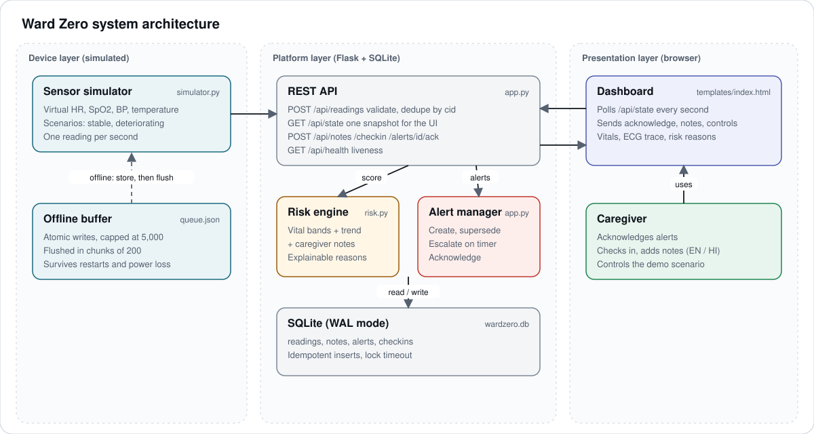
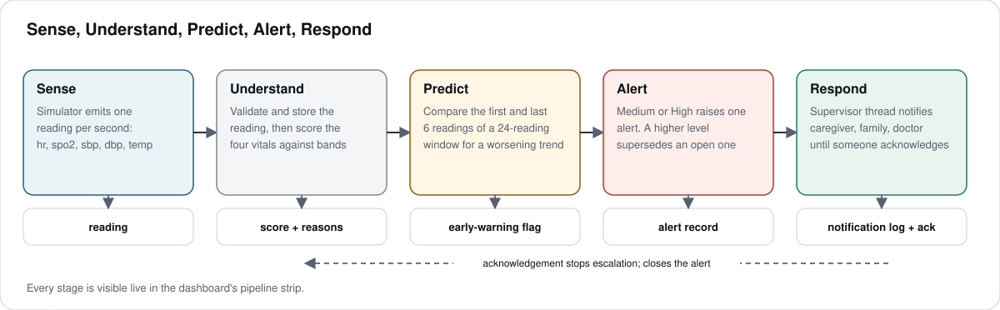
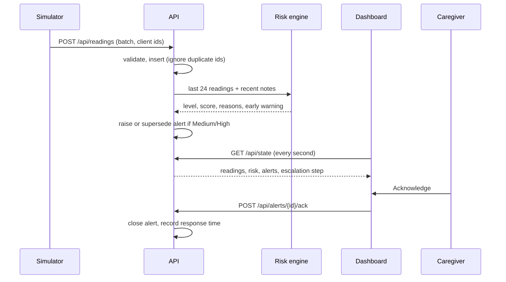
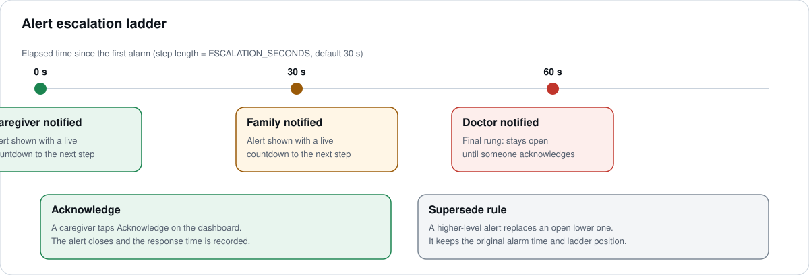
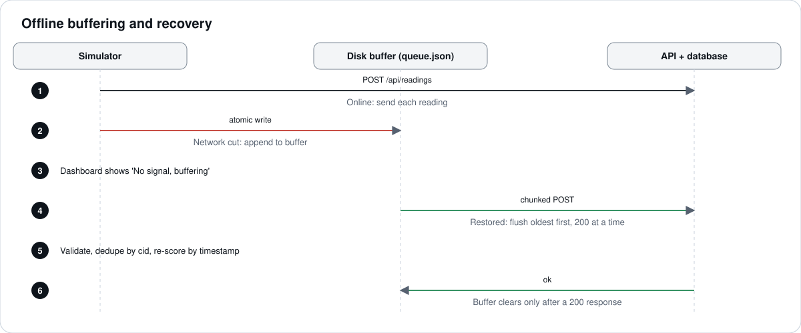

# Architecture

## Components

| Component | File | Responsibility |
|---|---|---|
| Sensor simulator | `simulator.py` | Generates vitals for a stable or deteriorating patient, sends them, buffers on failure |
| Offline buffer | `queue.json` | Atomic, capped (5,000) on-disk queue, flushed in chunks of 200 |
| REST API | `app.py` | Validates and stores readings, serves one state snapshot, handles notes, check-ins, acknowledgements and demo controls |
| Risk engine | `risk.py` | Pure functions: vital bands, trend, note keywords, level, reasons |
| Alert manager | `app.py` | Creates, supersedes, escalates and closes alerts |
| Database | SQLite (WAL) | `readings`, `notes`, `alerts`, `checkins` |
| Dashboard | `templates/index.html` | Single page; polls `/api/state` every second |

## Reading to response

## Data model

| Table | Columns | Notes |
|---|---|---|
| `readings` | `id`, `cid` (unique), `ts`, `hr`, `spo2`, `sbp`, `dbp`, `temp` | `cid` makes retries idempotent |
| `notes` | `id`, `ts`, `text` | Only notes newer than `NOTE_WINDOW_SECONDS` affect risk |
| `alerts` | `id`, `ts`, `level`, `reason`, `status`, `ack_by`, `ack_ts`, `esc` | `status`: `open`, `acknowledged`, `superseded` |
| `checkins` | `id`, `ts`, `name` | Latest row drives the "on duty" indicator |

## Alert lifecycle

- A new alert is raised when risk is Medium or High and no alert of the same or higher level was raised in the last 5 minutes.
- A higher alert supersedes open lower ones and keeps the original alarm time, so escalation timing and response time count from the first alarm.
- Escalation level is computed from the server clock on each state request and can only move forward.

## Resilience

## Design decisions

| Decision | Reason | Trade-off |
|---|---|---|
| Rules and trends instead of a trained model | Every alert can state why; no unvalidated "AI" medical claim | Less sensitive than a validated model |
| SQLite with WAL | Zero setup, survives restarts, handles concurrent dashboard and device requests | One host, one patient |
| Polling instead of WebSockets | Simple, robust through proxies, trivial to debug | One request per second per viewer |
| Server-driven escalation | Works when nobody is watching the screen | Needs a running server |
| One gunicorn worker in Docker | Demo control state lives in process memory | Not horizontally scalable as is |
| Dashboard served as a static file | No templating surface for injection; no build step | Single large file |
