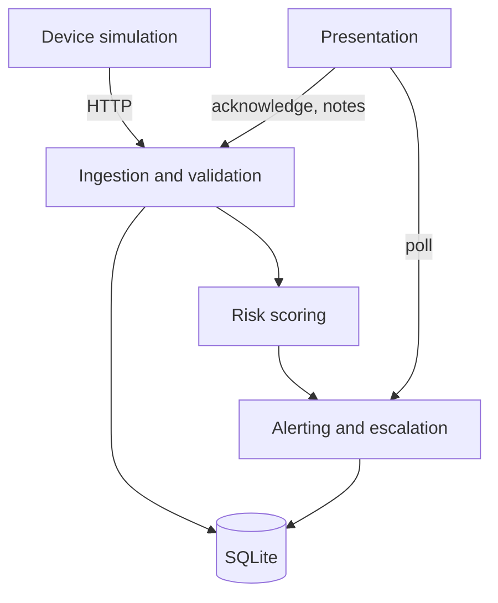

# Engineering assessment

A self-audit of the repository at version 0.3.0, structured like a modernization assessment: inventory, fingerprint, structure, debt, security, documentation, relative scale and recommendation.

## Executive summary

Ward Zero is a small (about 0.5 KSLOC of product code) Flask and vanilla-JavaScript prototype with a clean separation between device simulation, API, risk logic and UI. Average cyclomatic complexity is grade A (3.9) and no function exceeds grade B. Bandit reports no findings. The main risk is not code quality but scope: there is no authentication, so the service must stay on localhost. Recommendation: refactor in place, add authentication and a notification channel next, then replatform storage if multiple patients are needed.

## 1. System inventory

Tooling: non-blank line count per file (`scc` and `cloc` were not available), `radon` for complexity, `bandit` for security, `ruff` for lint. Reproduce with the commands in the [README](../README.md#development).

| File | Language | Non-blank lines |
|---|---|---|
| `app.py` | Python | 146 |
| `risk.py` | Python | 76 |
| `simulator.py` | Python | 67 |
| `demo.py` | Python | 39 |
| `templates/index.html` | HTML, CSS, JavaScript | 184 |
| **Product code** | | **512** |
| `test_ward.py` | Python (tests) | 61 |
| `scripts/make_diagrams.py` | Python (tooling) | 102 |

| Measure | Result |
|---|---|
| Functions analysed | 28 |
| Average cyclomatic complexity | A (3.9) |
| Highest complexity | `demo.main` 9, `app.clean` 8, `app.state` 8 (all grade B) |
| Maintainability index | A for every Python file |
| Tests | 10, all passing |
| Lint (`ruff`), security (`bandit`) | clean |

## 2. Technology fingerprint

| Area | Evidence |
|---|---|
| Language, runtime | Python 3.11+ (`pyproject.toml`), vanilla JavaScript |
| Framework | Flask 3 (`requirements.txt`) |
| Data store | SQLite file, WAL mode (`app.py: init`) |
| Integrations | None external; simulator to API over HTTP |
| Build, deploy | Dockerfile (gunicorn, non-root), docker-compose, GitHub Actions CI |
| Tests | `unittest` with the Flask test client (`test_ward.py`) |

## 3. Architecture at a glance

| Domain | Files | Depends on |
|---|---|---|
| Device simulation | `simulator.py` | API (HTTP) |
| Ingestion and validation | `app.py: clean, readings` | SQLite |
| Risk scoring | `risk.py` | none (pure functions) |
| Alerting and escalation | `app.py: maybe_alert, state, ack` | Risk, SQLite |
| Presentation | `templates/index.html`, `static/fonts` | `/api/state` |
| Operations | `demo.py`, `Dockerfile`, `.github` | all of the above |

## 4. Technical debt (ranked by remediation value)

| # | Finding | Evidence | Status |
|---|---|---|---|
| 1 | No authentication or roles | every route in `app.py` | Open, mitigated by localhost default |
| 2 | Demo control state is process-local | `SIM` in `app.py` | Open; Docker pins one worker |
| 3 | Alert logic lives in `app.py` and `GET /api/state` performs writes (escalation) | `state()` | Open; extract an alert service |
| 4 | Thresholds are constants, not configuration | `risk.py` band tables | Open |
| 5 | Trend window counts readings, not clock time | `risk.py: _trend` | Open; needs real history |
| 6 | Single patient, no `patient_id` | schema | Open |
| 7 | No schema migrations | `app.py: init` | Open |
| 8 | Dashboard is one dense file with inline CSS and JavaScript, no frontend tests | `templates/index.html` | Open |
| 9 | Actions pinned by major tag, not SHA; Docker image not built in the authoring environment | `.github/workflows/ci.yml`, `Dockerfile` | Open |
| 10 | `assess()` had cyclomatic complexity 24 | `risk.py` | **Resolved in 0.3.0** (now 6, behaviour identical on 5,000 random inputs) |

## 5. Security findings

No credentials were found in the repository. `bandit` reports no issues.

| Severity | CWE | Finding | Mitigation |
|---|---|---|---|
| High if exposed | CWE-306 Missing authentication | All endpoints, including `/api/sim`, are open | Binds to localhost; documented in `SECURITY.md`; roadmap item |
| Medium | CWE-319 Cleartext transmission | HTTP only | Use a TLS reverse proxy beyond localhost |
| Medium | CWE-770 Resource limits | No rate limiting | Batch cap 1,000, note 500, name 40 characters |
| Low | CWE-79 Cross-site scripting | All dynamic text is escaped; no Content-Security-Policy because the page uses inline script | Add a CSP when assets are split |
| Low | CWE-1104 Unmaintained or unpinned components | `requirements.txt` uses lower bounds | Pin with a lock file |

## 6. Documentation coverage

Present: README, technical documentation, architecture, API reference, risk model, roadmap, demo script, contributing, security, changelog. Remaining gaps a new engineer would hit:

1. Backup and restore of `wardzero.db`.
2. A clinical validation protocol for the risk model.
3. Data retention policy for notes and readings.
4. Accessibility test evidence (contrast and keyboard checks are designed in, not formally audited).
5. A deployment guide with TLS and authentication.

## 7. Relative scale

COCOMO-II basic index = 2.94 x (KSLOC)^1.10 = 2.94 x 0.512^1.10 = **1.41**, using 0.512 KSLOC of product code. This is a relative size measure for ranking systems only. It is **not** an estimate of time or cost.

## 8. Recommended pattern

**Refactor in place.** The structure is sound; the next gains come from extracting an alert service, adding authentication, and adding a notification channel. Replatform to PostgreSQL only when multiple patients or hosts are needed.
