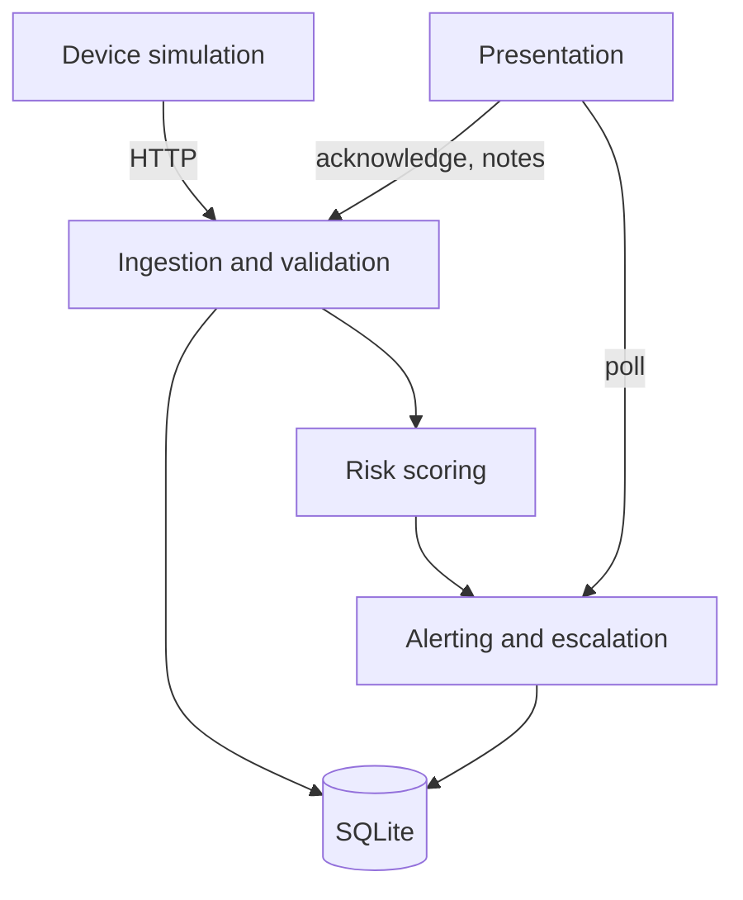

# Engineering assessment

A self-audit of the repository at version 0.4.0, structured like a modernization assessment: inventory, fingerprint, structure, debt, security, documentation, relative scale and recommendation.

## Executive summary

Ward Zero is a small (about 0.6 KSLOC of product code) Flask and vanilla-JavaScript prototype with a clean separation between device simulation, API, risk logic and UI. Average cyclomatic complexity is grade A (3.7) and no function exceeds grade B. Bandit reports no findings. The main risk is not code quality but scope: there is no authentication, so the service must stay on localhost. Version 0.4.0 added a supervisor thread (unattended escalation, a simulated notification log) and signal-loss detection; a real delivery channel and authentication are the next steps, then replatform storage if multiple patients are needed.

## 1. System inventory

Tooling: non-blank line count per file (`scc` and `cloc` were not available), `radon` for complexity, `bandit` for security, `ruff` for lint. Reproduce with the commands in the [README](../README.md#development).

| File | Language | Non-blank lines |
|---|---|---|
| `app.py` | Python | 202 |
| `risk.py` | Python | 76 |
| `simulator.py` | Python | 67 |
| `demo.py` | Python | 39 |
| `templates/index.html` | HTML, CSS, JavaScript | 187 |
| **Product code** | | **571** |
| `test_ward.py`, `test_risk.py` | Python (tests) | 150, 59 |
| `scripts/make_diagrams.py`, `scripts/e2e_check.py` | Python (tooling) | 105, 115 |

| Measure | Result |
|---|---|
| Functions analysed | 35 |
| Average cyclomatic complexity | A (3.7) |
| Highest complexity | `demo.main` 9, `app.clean` 8 (both grade B) |
| Maintainability index | A for every Python file (lowest: `app.py` 41.9) |
| Tests | 35 unit and integration tests plus a 15-check end-to-end script, all passing |
| Lint (`ruff`), security (`bandit`) | clean |

## 2. Technology fingerprint

| Area | Evidence |
|---|---|
| Language, runtime | Python 3.11+ (`pyproject.toml`), vanilla JavaScript |
| Framework | Flask 3 (`requirements.txt`) |
| Data store | SQLite file, WAL mode (`app.py: init`) |
| Integrations | None external; simulator to API over HTTP |
| Build, deploy | Dockerfile (gunicorn, non-root), docker-compose, GitHub Actions CI |
| Tests | `unittest` with the Flask test client (`test_ward.py`, `test_risk.py`) and a real-server end-to-end script (`scripts/e2e_check.py`) |

## 3. Architecture at a glance

| Domain | Files | Depends on |
|---|---|---|
| Device simulation | `simulator.py` | API (HTTP) |
| Ingestion and validation | `app.py: clean, readings` | SQLite |
| Risk scoring | `risk.py` | none (pure functions) |
| Alerting and escalation | `app.py: maybe_alert, state, ack` | Risk, SQLite |
| Presentation | `templates/index.html`, `static/fonts` | `/api/state` |
| Operations | `demo.py`, `Dockerfile`, `.github` | all of the above |

## 4. Technical debt (ranked by remediation value)

| # | Finding | Evidence | Status |
|---|---|---|---|
| 1 | No authentication or roles | every route in `app.py` | Open, mitigated by localhost default |
| 2 | Demo control state is process-local | `SIM` in `app.py` | Open; Docker pins one worker |
| 3 | Alert logic lives in `app.py`; `GET /api/state` still runs one supervision pass (a write) so the snapshot is never behind | `state()`, `cycle()` | Partly resolved in 0.4.0: a supervisor thread now escalates on its own. Extract an alert service next |
| 4 | Thresholds are constants, not configuration | `risk.py` band tables | Open |
| 5 | Trend window counts readings, not clock time | `risk.py: _trend` | Open; needs real history |
| 6 | Single patient, no `patient_id` | schema | Open |
| 7 | No migration framework | `app.py: init` | Partly resolved in 0.4.0: `init()` adds missing columns and tables (tested against a v0.3.0 database) |
| 8 | Dashboard is one dense file with inline CSS and JavaScript; no automated frontend tests (a headless-DOM run was done by hand during development, it is not part of CI) | `templates/index.html` | Open |
| 9 | Actions pinned by major tag, not SHA; Docker image not built in the authoring environment | `.github/workflows/ci.yml`, `Dockerfile` | Open |
| 10 | `assess()` had cyclomatic complexity 24 | `risk.py` | **Resolved in 0.3.0** (now 6, behaviour identical on 5,000 random inputs) |

## 5. Security findings

No credentials were found in the repository. `bandit` reports no issues.

| Severity | CWE | Finding | Mitigation |
|---|---|---|---|
| High if exposed | CWE-306 Missing authentication | All endpoints, including `/api/sim`, are open | Binds to localhost; documented in `SECURITY.md`; listed as future work |
| Medium | CWE-319 Cleartext transmission | HTTP only | Use a TLS reverse proxy beyond localhost |
| Medium | CWE-770 Resource limits | No rate limiting | Batch cap 1,000, note 500, name 40 characters |
| Low | CWE-79 Cross-site scripting | All dynamic text is escaped; no Content-Security-Policy because the page uses inline script | Add a CSP when assets are split |
| Low | CWE-1104 Unmaintained or unpinned components | `requirements.txt` uses lower bounds | Pin with a lock file |

## 6. Documentation coverage

Present: README, technical documentation, architecture, API reference, risk model, code tour, decision records, demo script, security, changelog. Remaining gaps a new engineer would hit:

1. Backup and restore of `wardzero.db`.
2. A clinical validation protocol for the risk model.
3. Data retention policy for notes and readings.
4. Accessibility test evidence (contrast and keyboard checks are designed in, not formally audited).
5. A deployment guide with TLS and authentication.

## 7. Relative scale

COCOMO-II basic index = 2.94 x (KSLOC)^1.10 = 2.94 x 0.512^1.10 = **1.41**, using 0.512 KSLOC of product code. This is a relative size measure for ranking systems only. It is **not** an estimate of time or cost.

## 8. Recommended pattern

**Refactor in place.** The structure is sound; the next gains come from extracting an alert service, adding authentication, and replacing the simulated notification log with a real delivery channel. Replatform to PostgreSQL only when multiple patients or hosts are needed.

## 9. Debug report for 0.4.0

A structured pass (reproduce, isolate, diagnose, fix, prevent) over the running system, not only the unit tests. Method: run the real server and simulator together, drive the demo, then stress the claims the README makes.

| # | Finding | Reproduction | Root cause | Fix | Prevention |
|---|---|---|---|---|---|
| 1 | **Silent failure.** If the device stopped sending, nothing alerted anyone; the last risk stayed on screen | Stop the simulator; the dashboard says "No recent data" forever, no alert, no escalation | Alerts were created only when a reading arrived | `watch_signal()` raises a signal-lost alert after `SIGNAL_LOSS_SECONDS` and closes it when data returns | `test_signal_loss_alert_raised_once_then_auto_resolved`, `test_second_silence_raises_a_second_alert`, e2e script |
| 2 | **Escalation depended on a browser.** The ladder only advanced when someone polled `/api/state`, and nothing was ever "sent" | Start an alert, never open the dashboard, read the database: `esc` stays 0 | Lazy escalation inside a GET handler | A supervisor thread runs `cycle()` every second; each rung writes one row to `notifications` (idempotent, unique per alert and rung) | `test_escalation_and_notifications_advance_without_any_dashboard_poll`, `test_notifications_are_idempotent`, e2e script reads only `/api/notifications` |
| 3 | **Hypothesis rejected: duplicate alerts under concurrency.** 16 threads posting High readings, 15 trials | Worst case was one open alert every time | The readings insert already takes SQLite's write lock before the alert check | None needed. The new background path takes `BEGIN IMMEDIATE` up front so it stays safe | `test_concurrent_requests_still_create_one_alert` |
| 4 | **Test leak.** One test set `ESC = 1` for the rest of the run | Reordering tests changed outcomes | Module-level global mutated and never restored | `setUp` resets `ESC` and `SIGNAL_LOSS` | Every supervisor test sets what it needs |
| 5 | **Misleading log.** A dead server was logged as "OFFLINE" like a cut network | Kill the server while the simulator runs | One flag for two causes | Log line now says `network cut` or `server unreachable` | Visible in the simulator output |
| 6 | **Clipped diagram.** The first box of the escalation figure was drawn off the left edge | Open `docs/images/escalation.svg` | Box x position was negative | Boxes re-positioned in `scripts/make_diagrams.py` | Figures are regenerated from code |

Verified by live run, comparing the reading ids held in `queue.json` with the ids in the database afterwards: a network cut of about 8 seconds buffered 8 readings and all 8 were stored; killing the server with `kill -9` for about 8 seconds buffered 8 readings and all 8 were stored after restart; in both runs there were no missing readings and no duplicates.
