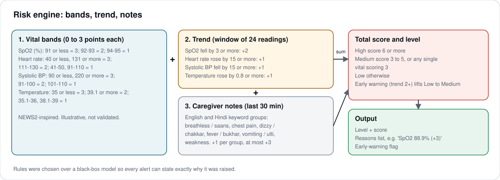

# Risk model

Experimental and illustrative. It is inspired by the structure of the NEWS2 early-warning score but is **not** NEWS2 and has **not** been clinically validated.

## 1. Vital bands (latest reading)

| Vital | 3 points | 2 points | 1 point | 0 points |
|---|---|---|---|---|
| SpO2 (%) | 91 or less | 91 to 93 | 93 to 95 | above 95 |
| Heart rate (bpm) | 40 or less, 131 or more | 111 to 130 | 41 to 50, 91 to 110 | 51 to 90 |
| Systolic BP (mmHg) | 90 or less, 220 or more | 91 to 100 | 101 to 110 | 111 to 219 |
| Temperature (C) | 35 or less | 39.1 or more | 35.1 to 36, 38.1 to 39 | 36.1 to 38 |

Bands are evaluated in order, so there are no gaps between them.

## 2. Trend (proxy for 24 to 48 hour deterioration)

Over the last 24 readings (minimum 12), compare the mean of the first 6 with the mean of the last 6:

| Change | Points |
|---|---|
| SpO2 down by 3 or more | +2 |
| Heart rate up by 15 or more | +1 |
| Systolic BP down by 15 or more | +1 |
| Temperature up by 0.8 or more | +1 |

A trend score of 2 or more is an **early warning**.

## 3. Caregiver notes

Notes from the last 30 minutes are matched against English and romanized or Devanagari Hindi keyword groups: breathlessness (breathless, saans), chest pain, dizziness (dizzy, chakkar), fever (fever, bukhar), vomiting (ulti), weakness or confusion (weak, kamzori, confused). Each group found adds +1, up to +3.

## 4. Level

| Condition | Level |
|---|---|
| Score 6 or more | High |
| Score 3 to 5, or any single vital scoring 3 | Medium |
| Otherwise | Low |
| Early warning while otherwise Low | raised to Medium |

## Worked example

| Source | Detail | Points |
|---|---|---|
| Vitals | HR 120 (+2), SpO2 87.7 (+3), SBP 101 (+1), Temp 38.5 (+1) | 7 |
| Trend | SpO2 92 to 88 (+2), heart rate +20 (+1) | 3 |
| Notes | "saans phool rahi hai, chakkar": breathlessness, dizziness | 2 |
| **Total** | | **12, High, early warning** |

The dashboard shows each line as a reason with its points.

## Safety notes

- Output wording is hedged ("possible deterioration").
- Every result lists its reasons, so a clinician or caregiver can disagree with it.
- Inputs are validated; implausible readings are rejected rather than scored.
- The engine is a pure function (`risk.assess`) and is covered by tests, including bands without gaps and note expiry.
