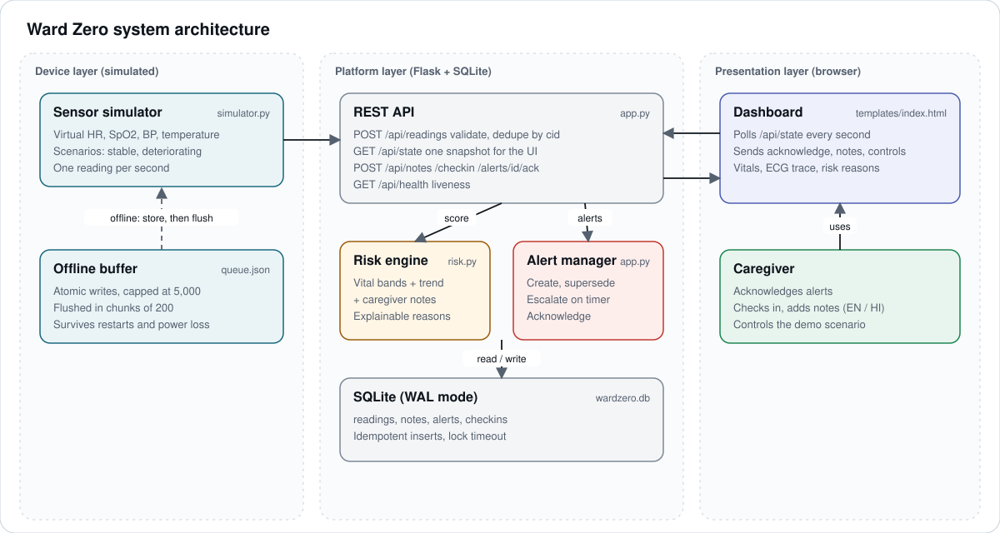
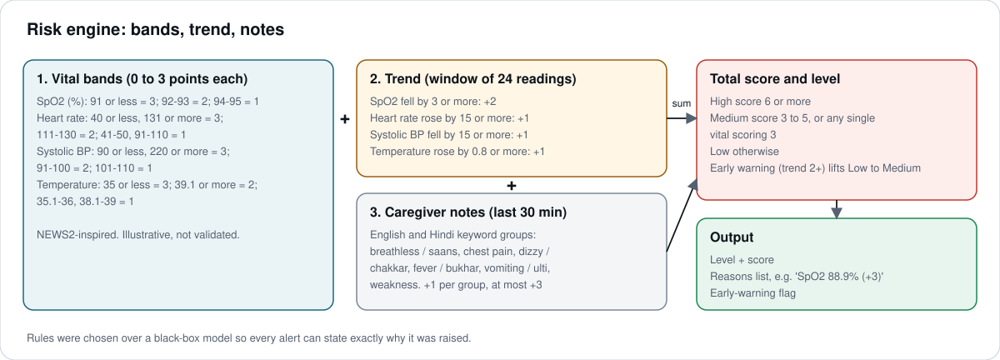
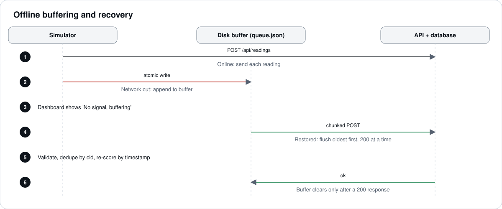

# Technical documentation

Submission document for **Operation Ward Zero**. It follows the structure the organisers asked for.

## 1. Problem understanding and proposed solution

**Problem.** A patient recovering at home is watched by family members and an occasional thermometer reading. Deterioration is noticed late, caregivers are not always present, and nobody can tell whether an alert was seen.

**Solution.** Ward Zero is a software-only home-care ward. A simulated device streams vitals to a platform that scores risk with explainable rules, predicts deterioration from trends, raises alerts, escalates them to the right person and records the caregiver's response. It keeps working through connectivity loss.

## 2. System architecture and technology stack

| Layer | Technology | Why |
|---|---|---|
| Device simulation | Python, `requests` | Realistic client with retries and an offline buffer |
| Platform | Flask, SQLite (WAL) | Zero setup, persistent, concurrent-safe for the demo |
| Risk engine | Plain Python functions | Explainable and unit-testable |
| Dashboard | HTML, CSS, JavaScript, Canvas | No build step; self-hosted fonts work offline |
| Quality | `unittest`, ruff, bandit, GitHub Actions | Tests, lint and security scan on every push |
| Packaging | Docker, docker-compose, gunicorn | Reproducible run |

## 3. Major features

| Capability | Behaviour |
|---|---|
| Patient monitoring | Heart rate, SpO2, blood pressure, temperature; live values, sparklines and a simulated ECG |
| Caregiver monitoring | Check-in with "on duty" status; acknowledgement records who responded and how fast |
| System reliability | Atomic offline buffer, chunked flush, idempotent writes, input validation, device-state indicator |
| Contextual intelligence | Vitals, short-term history (trend) and English or Hindi caregiver notes combined in one score |
| Predictive analytics | Trend rules over a 24-reading window raise an early warning |
| Alert and escalation | Low, Medium, High; caregiver, then family, then doctor on a timer; higher alerts supersede lower ones |

## 4. Data processing and risk assessment approach

1. Validate each reading (ranges, finite numbers, plausible timestamp). Reject bad ones without failing the batch.
2. Store with a client-generated id so retries cannot create duplicates.
3. Score the latest reading against vital bands, add trend points and note points.
4. Map the total to Low, Medium or High and return the list of reasons.
5. Raise, supersede or leave alerts; escalation advances with the server clock.

Details and a worked example: [RISK_MODEL.md](RISK_MODEL.md).

## 5. Reliability and resilience

Verified by tests and live runs: cutting the network buffers readings, restoring it flushes them in order, and the database contains exactly one copy of each.

## 6. Explainability and clinical safety

- Each result lists its reasons with points; the dashboard shows them verbatim.
- Language is hedged. The product never states a diagnosis or recommends treatment.
- Synthetic data only; thresholds are labelled illustrative on every screen and in the docs.
- Safe defaults: localhost binding, no caching of API responses, escaped output.

## 7. How the evaluation criteria are met

| Criterion | Evidence |
|---|---|
| End-to-end integration (25%) | Live pipeline strip: Sense, Understand, Predict, Alert, Respond update from real state |
| Technical skills (20%) | Layered code, pure risk functions (max complexity 7), 10 tests, CI, [assessment](ASSESSMENT.md) |
| Reliability and resilience (20%) | Offline buffer, idempotency, validation, WAL, differential and regression tests |
| Practical implementation (20%) | One-command demo, caregiver workflow, Hindi and English notes, light and dark UI, Docker |
| Explainability and clinical safety (15%) | Reasons on every alert, hedged wording, disclaimers, no real data |

## 8. Assumptions, limitations and future improvements

**Assumptions.** One patient, one device, a trusted local network, synthetic data.

**Limitations.** Illustrative thresholds, not clinically validated. The trend window counts readings, not hours. No login. In-app alerts only. The Docker image has not been built by the author's tooling (the gunicorn command it uses was run and verified).

**Future work.** Authentication and roles, SMS or WhatsApp escalation, multiple patients, time-based history, validated models with clinical partners, push updates instead of polling. See [ROADMAP.md](ROADMAP.md).

## 9. Setup

See the [README](../README.md#quick-start). Run the tests with `python -m unittest -v`.
